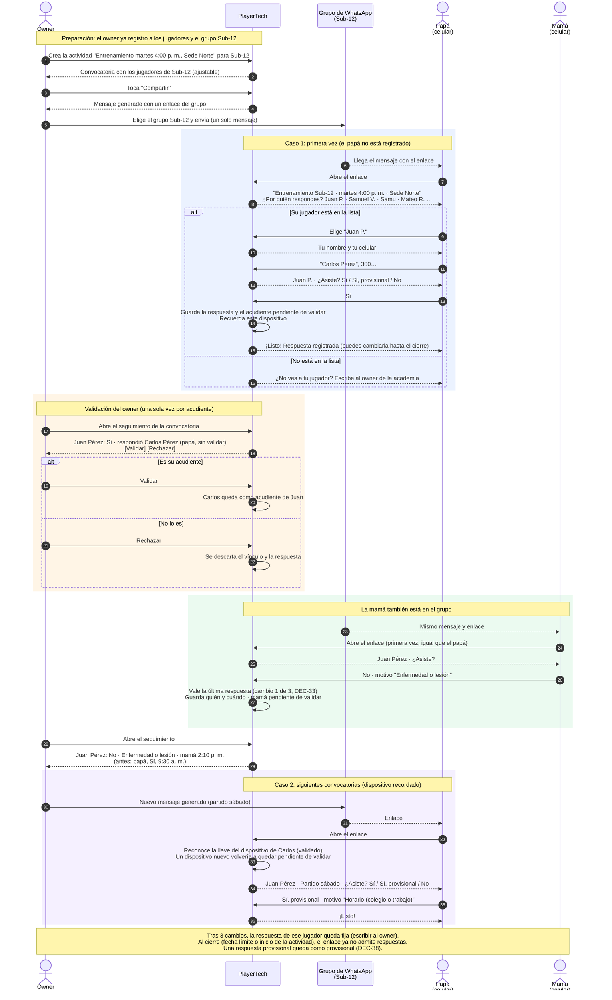

# Flujo de convocatoria y respuesta del acudiente

> **Decisión de la ideación de la Fase 2 (2026-10-18).** DEC-31 y DEC-33 de `docs/architecture/decisions.md` (ADR-018): un enlace por grupo, identificación del acudiente en el primer uso, validación del owner, dispositivo recordado y hasta 3 cambios de respuesta.

## Objetivo

Reemplazar el mensaje que el administrador escribe a mano en el grupo de WhatsApp de cada categoría por **un mensaje generado automáticamente, con un solo enlace por grupo**. Los padres no necesitan estar registrados de antemano, y siempre se sabe quién respondió.

## Diagrama de secuencia

## Cómo leerlo

| Bloque | Qué muestra |
|---|---|
| Preparación | El owner crea la actividad para un grupo y comparte **un solo mensaje** generado en el grupo de WhatsApp |
| Azul: primera vez | El padre elige a su jugador en la lista de convocados (nombre e inicial del apellido), escribe su nombre y su celular, y responde de inmediato |
| Naranja: validación | El owner valida o rechaza con un toque el vínculo de cada acudiente nuevo, solo la primera vez |
| Verde: segundo acudiente | La mamá se vincula por su cuenta. Vale la última respuesta y el owner ve quién respondió y el historial |
| Morado: siguientes veces | El dispositivo recordado (una llave secreta, no el celular) lleva directo a responder. Un dispositivo nuevo vuelve a quedar pendiente de validar |

## Reglas que refleja

- **Un mensaje por grupo** con un solo enlace; sin mensajes individuales.
- **Sin registro previo de los padres**: el vínculo nace en el primer uso.
- **Cada acudiente tiene su propio vínculo**: siempre se sabe quién respondió.
- **Identificación sin códigos**: enlace secreto del grupo, validación del owner de cada vínculo y dispositivo nuevo, y una llave secreta en el dispositivo. El celular es solo contacto (DEC-31).
- **Respuestas**: Sí, Sí provisional o No, con un motivo opcional de una lista fija en las dos últimas; *Otro* pide texto (DEC-38). Hasta 3 cambios por jugador, siempre antes del cierre (DEC-33).
- **Privacidad de menores**: la lista muestra solo el nombre y la inicial del apellido. El enlace es secreto y caduca al cierre. Sin código de familia (DEC-31).
- **Respuestas sin validar**: se distinguen en el seguimiento hasta que el owner las valida.
